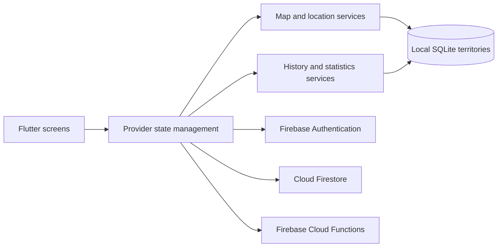

<div align="center">


# ZoneRun

**Turn outdoor movement into a location-based territory challenge.**

Flutter · Dart · Google Maps · GPS · SQLite · Firebase · Provider

[Original technical architecture (Turkish)](docs/ORIGINAL_README_TR.md) · [Developer profile](https://github.com/AhmetKoca32)

</div>

## Overview

**ZoneRun** is a Flutter mobile app exploring a location-based fitness game: a user walks a route, records GPS positions, closes the route into a polygon, and saves the resulting territory. The experience combines map interaction and geometric calculations with activity statistics, challenges, and customizable profiles.

**Project scope:** A personal development project. This repository documents the implementation and does not claim a public app-store release or verified production deployment.

## Main features

- **GPS-based territory capture:** Collect location updates while moving and draw a route on Google Maps.
- **Polygon area calculation:** Convert geographical positions to local metric coordinates and calculate approximate area using the **Shoelace formula**.
- **Saved territories:** Store completed polygons in a local SQLite database, revisit previous routes, and delete saved records.
- **Activity insights:** Display captured area, polygon counts, estimated distances, and statistics from recorded activity.
- **Progression and customization:** Task progress, rewards, avatars, banners, titles, and accessories.
- **User account flows:** Firebase Authentication, including email-based authentication and Google sign-in paths.
- **Supporting experience:** Onboarding, localization, notifications, charts, and estimated activity calories.

Some modules include prototype or development-specific logic. These features describe the codebase, not independently verified end-to-end production behavior.

## Technology stack

| Component | Technology |
| --- | --- |
| Mobile | Flutter, Dart |
| State management | Provider / ChangeNotifier |
| Maps and location | `google_maps_flutter`, `location` |
| Local persistence | SQLite via `sqflite` |
| Cloud services | Firebase Authentication, Firestore, Cloud Functions |
| Backend functions | TypeScript, Firebase Functions (Node.js 24 in configuration) |
| Data visualization | `fl_chart` |
| Notifications | `flutter_local_notifications`, `timezone` |
| Local preferences | `shared_preferences` |
| UI assets | Custom avatars, banners, and light/dark themes |

## How territory capture works

1. The app requests the necessary location permission and subscribes to GPS position updates.
2. `MapProvider` maintains the route as a list of coordinates and filters successive points.
3. When the route is ready to close, `MapService` converts geographical coordinates to an approximate local metric plane.
4. The **Shoelace formula** estimates the area of the closed polygon.
5. The app saves the polygon and its calculated area in **SQLite**; history and statistics services read that data.

For polygon vertices `(xᵢ, yᵢ)` expressed in a local metric plane, the calculation follows:

```text
Area = 1/2 × |Σ (xᵢ × yᵢ₊₁ − xᵢ₊₁ × yᵢ)|
```

Area is an **estimate**, not cadastral/survey-grade measurement. Accuracy depends on GPS quality and coordinate conversion.

## Architecture



### Repository structure

```text
lib/
  core/
    constants/      App configuration and game settings
    models/         Polygon and coordinate models
    services/       SQLite, GPS, Firebase and notifications
    utils/          Geometry and calorie estimation helpers
    theme/          Light/dark theme and design tokens
  features/
    auth/           Authentication screens and providers
    home/           Dashboard and motivation
    map/            Map view, location tracking and territories
    history/        Completed polygons and activity metrics
    profile/        Account, stats, tasks and rewards
  l10n/             Localization resources

functions-backend/
  src/              Firebase callable function handlers

assets/
  icons/            App identity
  avatars/          Profile avatar assets
  banners/          Reward and profile banners

docs/
  ORIGINAL_README_TR.md
```

## Getting started

### Requirements

- Flutter SDK with a compatible Dart release (`pubspec.yaml` declares **Dart SDK `^3.10.1`**)
- Android Studio / Xcode and a configured emulator or physical device
- A **Google Maps API key** configured for the target platform
- Your **own Firebase project** with the necessary enabled services and platform configuration
- Location services and permissions on the test device

### Mobile app

```bash
git clone https://github.com/AhmetKoca32/ZoneRun.git
cd ZoneRun
flutter pub get
flutter run
```

**Environment note:** `pubspec.yaml` references an `.env` asset. Create a local environment file with only the values needed by your setup; never commit real keys. Because Firebase and Google Maps configuration is environment-specific, `flutter pub get` alone does not make the application runnable.

In debug mode, `lib/main.dart` configures Firebase Functions to use a local emulator. Run/configure the matching emulator or adjust your private development environment as appropriate.

### Backend functions

The repository also contains TypeScript-based Firebase functions:

```bash
cd functions-backend
npm install
npm run build
```

This only builds the functions; it does not deploy them. Review the Firebase configuration before connecting them to any real cloud project.

### Local checks

```bash
flutter analyze
flutter test
```

These commands are offered for local verification. No passing build, automated test result, or CI status is claimed in this document.

## Development notes

- **Persistence:** Territory history is stored locally with SQLite, while Firebase handles separate account/cloud functionality.
- **Activity estimates:** Distances derive from route geometry, and calories are estimated using a MET-based calculation rather than a medical measurement.
- **Platform permissions:** Continuous location use and notifications require device-specific permissions.
- **Development stage:** Some flows, especially cloud-related and purchase-validation functions, require additional setup and should not be interpreted as verified live payment features.

## Original documentation

The original detailed Turkish README remains available **unchanged** in [docs/ORIGINAL_README_TR.md](docs/ORIGINAL_README_TR.md). It includes the original folder-by-folder architecture explanation, coding conventions, design guidelines, and feature development notes.

## Developer

Developed by [**Ahmet Koca**](https://github.com/AhmetKoca32), a computer engineering graduate working across backend, mobile, and full-stack applications.

[LinkedIn](https://www.linkedin.com/in/ahmetkocaa/) · [GitHub](https://github.com/AhmetKoca32)
